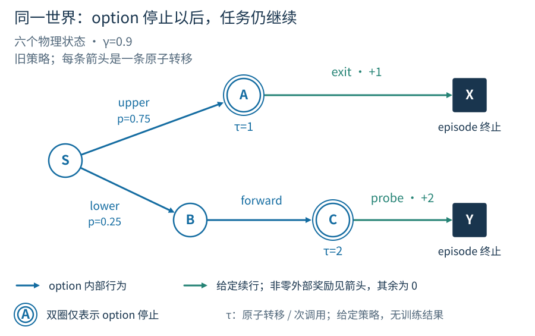
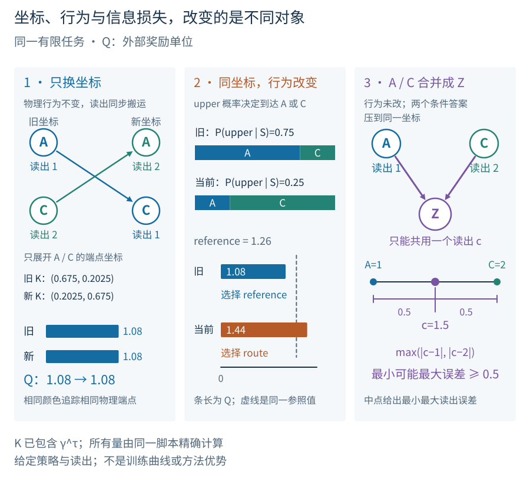

# 学习改变了记忆与行为，已有知识还适用吗？

<a id="shared-learning-inquiry"></a>

<a id="joint-setting"></a>

## 1. 记忆与行为一起学习时会发生什么？

假设智能体已经学会预测两条路线的收益。后来，它开始记住一条先前忽略的提示，也更熟练地选择路线。旧预测此时可能变差：同一个内部数值可能代表了不同的历史，同名技能也可能更常到达另一个终点。这两种变化要求不同的修正。前者要检查预测器怎样读取新的状态，后者要重新了解行为的实际后果。

[状态章](../textbook/state.md#lesson-learned-memory)研究奖励反馈怎样改变记忆写入，[子目标章](../textbook/goals.md#lesson-learning-cycle)研究技能怎样通过经验形成，[架构章](../textbook/architectures.md#lesson-learning-components)讨论后果模型怎样帮助规划。这里选取 CRL 中的一个问题，考察这些学习同时发生时，已有预测还能怎样支持下一次选择。

考虑一个拟议任务：有 $S\to A$ 与 $S\to B\to C$ 两条路线，A、C均可 exit 到X或 probe 到Y，X、Y则一步强制返回S。每次到达X/Y，先结算旧奖励，再独立等概率抽取隐藏模式 $Z\in\{-1,+1\}$，短暂显示准确提示 $c=Z$；回到S后提示消失，模式保持至下次到达X/Y。所有位置可见，A、C的exit奖励恒为1，A的probe为0，C的probe在 $Z=+1$ 时为2、否则为0，其余转移为0。

比较包含返回的完整行程，正提示下较长的C路线值得选择，负提示下较短的A路线更合适。但作出选择时，两种情况下看到的都是S。提示与选择之间隔着一次真实返回，只看当前位置无法恢复提示。初始在X抽提示，此后无外部重置，记忆与参数不清空。提示是关于隐藏模式的唯一直接输入；学习器只取得所选动作的反馈，不能读取环境内部变量或未选路线结果。

$$
h_t=(\operatorname{onehot}(L_t),m_t),\qquad m^+=(1-g)m+gc,\qquad g=\sigma(\eta).
$$

$L_t$ 为可见位置。只学习新提示到达时的写入参数 $\eta$；其余时刻保持 $m$、位置编码与提示时刻标志均给定，初始 $m=0,g=1/4$。$h_t$ 由运行期间各版参数形成，更新参数不重算过去。

这个写入门同时保留旧活动和当前提示。由于每次模式重新独立抽取，上一轮留下的活动可能妨碍辨认当前模式；增大新提示的权重可能帮助选择。不过，改变写入参数不会立即重建已经存在的活动。预测器在更新前后看到的数值及其含义，取决于活动是怎样沿实际历史形成的。这里研究的是这种有限记忆的学习，提示发生时刻与位置编码仍由任务给定。

路线 option 的启动集给定为 $I=\{S\}$，在A/C停止，B只执行forward；仅学习S处分支参数 $p_{\rm upper}(m)=\sigma(b-\kappa m)$，初值 $b=0,\kappa=1$。另有相同边界、固定 $p_{\rm upper}=1/2$ 的参照技能供规划比较。停止后给定A执行exit、C执行probe，使比较集中于路线学习。写入门、路线参数及后果模型都只从实际反馈学习；实验开始前需确定完整的更新规则。

现在可以看见三个学习过程怎样相互影响。写入门改变提示在记忆中的作用，路线策略据此改变到达A/C的概率，后果模型则要预测当前技能需要多久、停在哪里。模型若仍按旧技能估值，高层就可能继续偏爱原来的参照技能，减少新技能的执行机会。于是，模型跟不上行为还可能使它更难获得修正所需的经验。这个反馈是否发生、强到什么程度，需要在实际学习中测量。

这项比较预设总预算 $B=10^5$ 个原始步，含练习、返回和更新已有知识期间的交互；每步至多两次模型备份，不存轨迹回放。四种配置共用观测、七维主状态、两技能及模型/高层更新器。固定技能时另用旧写入门更新 $m^{\rm ref}$，使它对同一历史仍给出相同的动作与停止分布；该参照活动、旧参数及计算在全部配置中同额保留计费。后文的 knowledge_transport 程序只计算给定终止图的后果，这项POMDP中的联合训练仍有待实现。

<a id="joint-continual-objective"></a>

## 2. 学习过程中的收益与代价

两种方法最后可能学会同样好的策略，过程中获得的奖励却不同。一个方法较早识别提示，另一个方法先花许多行程校正旧模型；只在学习结束后测试，两者可以看起来一样。学习中的失误、技能练习和模型修正都消耗原始交互步。计算若延迟了实际行动，还要计入等待时间。这里因此评价带着记忆继续更新的整个学习器，并另外测量预测误差来解释收益怎样变化。

[Abel 等的定义](https://arxiv.org/html/2307.11046v2#S4)相对于指定的行为基础，要求最优智能体持续搜索而不最终停在某个基础行为上。这里在有限资源下累计学习全过程的奖励，以研究学习成本；上述固定规律的有限任务是否满足该严格定义，尚未得到证明。

$$
J_B(\mathcal A)=\mathbb E_{\mathcal A}\!\left[\sum_{t=0}^{B-1}R_{t+1}\right],\qquad g(\mathcal A)=\lim_{T\to\infty}\frac1T\mathbb E_{\mathcal A}\!\left[\sum_{t=0}^{T-1}R_{t+1}\right].
$$

$\mathcal A$ 包含全部在线更新，$B$ 是有限的原始交互步预算；仅在极限存在时定义 $g$。同一 $B$ 下 $J_B/B$ 与 $J_B$ 排序相同，长期极限却会忽略有限启动损失。技能调用次数不能代替时间；物理部署另将动作等待与计算延迟纳入时钟。

状态与技能的联合学习只是长期学习中的一种困难。即使这两个部分固定，智能体仍可能需要选择预测问题、处理奖励或环境变化、分配探索经验、保留低频能力以及维持学习新目标的速度。下面的小任务用来隔离旧知识为何失准；关于资源怎样在这些需求之间分配，还要依靠后面的各组研究问题分别展开。

<a id="joint-three-changes"></a>

## 3. 预测为什么会变差？

先保持环境、预测问题和历史条件行为不变，只交换表示方式。例如将记忆数值的符号翻转：若读出仍把正数解释为原来的提示，答案就会出错，尽管信息还在。更一般地，若新旧摘要在相关历史上满足 $\widetilde h=T(h)$，且 $T$ 可逆，可通过逆变换读取旧知识。要使这种等价在下一步继续成立，递推和策略也必须同步改变：

$$
\widetilde q(T h)=q(h),\qquad\widetilde\pi(a\mid T h)=\pi(a\mid h),\qquad\widetilde f(T h,u)=T f(h,u).
$$

这里 $q$ 是旧读出，$u$ 是一次动作及反馈；这些是已知可逆 $T$ 下的构造恒等式。模型的终点分布也须经 $T$ 变换。它不保证受限函数类能表达运输结果，也不保证能从有限数据识别 $T$。

写入参数改变后，是否存在这样的可逆关系，需要另行检查。新旧摘要必须在所比较的相关历史上满足同一个变换，过去各步使用不同参数形成的活动也要纳入比较；网络维度相同并不提供这项保证。即使数学上存在变换，受限读出也未必能表达它。已知重编码因而提供一个可精确检验的对照：如果连这一情形也无法恢复原输出，先检查读出、递推或模型是否漏改了。

再考虑信息被合并的情形。两段历史只在先前提示上不同，而新摘要都把它们表示为同一个值。若固定行为在这两段历史下的期望回报不同，只读取新摘要的预测器就只能给出一个共同答案。增加读出训练可以改变这个答案，却不能同时恢复两个条件答案。此时应改变记忆保留的信息，或承认预测必须承受这种近似误差。

技能学习改变的是另一项条件。即使相同历史仍产生相同摘要，路线策略更常选C，也会改变技能的终点和时长分布。把旧预测的输入重新表达一遍，不会把原来的行为后果变成新后果。需要的新信息来自新技能的执行，或来自能够正确推算该行为的模型。策略参数没有更新也未必意味着技能没变：如果策略读取的记忆变了，它对同一历史的动作分布仍可能变化。

最后，误差还取决于在哪里测量。技能开始访问少见的历史后，过去很少被计入的错误会变得突出；受限函数类在新分布下最合适的近似也可能改变。比较更新前后的平均误差，应同时保留一组共同的历史条件问题，并报告实际到访分布下的误差。前者帮助辨认预测本身怎样变化，后者反映当前行动真正面对哪些错误。

<a id="joint-question-and-option"></a>

## 4. 两次预测回答的是同一个问题吗？

判断旧预测是否仍然适用，需要知道它原本回答什么。[预测知识章](../textbook/gvf.md)的 GVF 规格 $\xi=(c,\gamma,\pi)$ 规定累积信号、延续系数和目标策略。将它们定义在历史及可观测转移上，便可以在网络表示改变后继续指明同一问题。若 $|c|$ 有界且 $0\leq\gamma\leq\bar\gamma<1$，其条件回报可积：

$$
v_\xi(H_t)=\mathbb E_\pi\!\left[\sum_{j=0}^{\infty}\left(\prod_{k=1}^{j}\gamma_{t+k}\right)C_{t+j+1}\,\middle|\,H_t\right].
$$

空乘积为 1。学习 $\widehat v_\xi$ 改变答案估计；更换 $c,\gamma,\pi$ 改变规格。若信号由活动坐标产生，构造器更新也可能改变规格，即使问题编号未变。

例如，“按这条路线走到停止时，会到达C吗”同时规定了行为和要观察的事件。若只换状态编码，问题可以保持不变；若路线策略改变，就应区分旧路线和新路线的答案。若把“到达C”改成“某个隐藏单元超过阈值”，又允许该单元继续学习，连被预测的事件也可能改变。清楚的规格让预测错误可以被经验检验，也让旧经验是否仍相关成为一个具体问题。

技能也有同样的问题。一个 [option](../textbook/options.md)虽沿用名称 $\omega$，它对同一历史选择什么动作、何时停止，可能已经不同。这里用版本 $\nu$ 指定其历史条件策略与停止规则，再用 $\zeta$ 标记启动时构造器、活动及段内更新规程；这些因素还会影响同一终点的表示尾值。对正且有限期望的时长 $\tau$、有界奖励与尾值，定义

$$
B^{\nu,\zeta}_{g,V}(H_t,\omega)=\mathbb E_{\omega^\nu,\zeta}\!\left[G-g\tau+V(h_{t+\tau})\mid H_t\right],\qquad G=\sum_{i=0}^{\tau-1}R_{t+i+1}.
$$

本式 $g$ 是给定的每原始步奖励率，$V$ 是给定尾值，备份时二者固定；$G$ 是外部奖励，$\tau$ 按原始步计。诊断时冻结或等价运输技能与表示接口，技能停止保留尾值。若 $h_t$ 不足以区分历史，拟合后果还依赖采样中的历史混合。

这个期望包含三项可以分别出错的预测：执行期间获得多少奖励、占用多少原始时间，以及停止后处于怎样的状态。当前任务在A/C继续行动，所以技能停止时仍要保留尾值。用于鼓励练习的子任务奖励则不应混入真实收益。版本标记用于说明比较条件；两个不同版本如果产生完全相同的相关后果，模型也可能继续适用。反过来，保留同一名字并不能保证后果没变。

<a id="joint-transport-diagnostic"></a>

## 预测改变后，选择是否也会改变？

先把学习过程暂时固定下来，直接计算一个模型错误会不会改变选择。这里固定正模式，并将任务改为一次到达 X/Y 即结束，去掉前面拟议任务中的返回与持续更新。技能从 S 到 A 或 C 就停止，之后固定在 A 执行 exit、在 C 执行 probe，分别取得 1 和 2；任务才在 X 或 Y 结束。技能选上路的概率记为 p，到 A 需一步，到 C 需两步。图中只画这些被执行的路径。



双圈标出技能停止点。先到 A 再到 X，或经 B、C 到 Y；每条边是一原始交互步。停止技能并不删除后续奖励。此图固定行为及后果，用来计算模型备份。

$$
Q(p)=0.9p\times1+0.9^2(1-p)\times2.
$$

技能执行期间的奖励为零，尾值为 $V(A)=1,V(C)=2$，折扣率为 $0.9$。这是一项给定续行下的折扣备份，不是前面持续学习器的生命期目标。

第一项对应到A后取得的奖励，第二项对应多走一步到C后取得的奖励。模型必须同时保留终点概率和到达时间，才能得到这个比较。只知道最终总能到达A或C还不够，把技能停止当成任务结束则会错误地删掉两项尾值。



数值来自完整路径枚举与独立矩阵计算。左：模型与读出同步变换，1.08 保持不变。中：上路概率由 0.75 变为 0.25，实际备份变为 1.44，超过参照行为的 1.26。右：A 与 C 合成一个坐标 Z，任何共同读出对答案 1、2 的最大误差至少为 0.5。手机按上、中、下阅读。

参照行为以相同概率选择两条完整路径，期望折扣回报为 1.26。旧技能的上路概率为 0.75，备份 1.08 低于参照；新技能把该概率降到 0.25，真实备份 1.44 已高于参照。若规划仍读取旧模型，就会继续选参照行为。这里问题没有出在状态命名，而在新技能更常到达C；对旧模型作可逆重编码仍只会得到 1.08。

模型错误也未必造成选择错误。若上路概率只改到 2/3，真实值为 1.14，修正模型后仍会选择参照行为。两项诊断由此分开：模型误差衡量预测偏离真实后果多少，决策比较检查这种偏离是否改变行动排序。当前排序不变，也不意味着该误差对所有起点、后续价值或未来比较都无影响。

合并 A、C 后，可以专门拟合一个共同读出，让旧起点 S 的备份仍为 1.08。这个拟合只满足两条路径加权后的一个等式，无法同时满足从A出发的答案1和从C出发的答案2。无论共同读出取何值，至少一个条件答案的误差不小于0.5。因此，起点总分恢复不等于条件信息恢复；诊断必须包含会暴露被合并差别的查询。

[下载并运行这个算例](../tutorials/knowledge_transport.py)，可以核对图中的全部数值。程序使用 Python 标准库：test 比较路径枚举与矩阵计算，并检查坐标运输和信息合并；demo 给出每条路径、终点概率、时长、读出和比较结果。这里的概率由分析给定，没有进行状态或技能的联合训练。

```bash
python3 tutorials/knowledge_transport.py test
python3 tutorials/knowledge_transport.py demo
```

将文件下载到当前目录后运行；demo 输出 JSON，可核对图中全部数值。

<a id="joint-existing-answers"></a>

## 5. 已有知识可以怎样继续使用？

[GVFN](https://arxiv.org/html/1807.06763v4#S4)让递归状态中的量回答指定的预测问题，状态学习因而获得了关于未来的训练目标。论文同时展示了问题选择的影响：有的预测集合虽足以表示所需信息，却难以及时学准。对这里的任务，预测目标必须能使记忆保留有助于选择路线的提示，还要能从实际到访中学到。指定可解释的问题提供了检查状态的方式，自动选择既有用又可学的问题仍需另外研究。

[STOMP](https://arxiv.org/html/2202.03466v3#S4)让子任务形成行为，学习这些行为的真实后果，再用模型规划。[后果模型](../textbook/models.md)的用途由此体现在[规划](../textbook/planning.md)中的选择。论文实验依次完成这些阶段，并将同时学习及规划用途对早期构造的反馈列为后续问题。这里进一步允许递归状态改变，就必须检查技能是否仍执行同一行为，以及模型所预测的终点特征是否仍有原来的含义。

[后继特征](https://proceedings.neurips.cc/paper/2017/file/350db081a661525235354dd3e19b8c05-Paper.pdf)则区分会遇到什么与这些后果值多少。在奖励可写成 $r=\phi^\top w$ 时，固定策略价值分解为 $Q^\pi=(\psi^\pi)^\top w$，其中 $\psi^\pi$ 预测折扣特征累积。固定动力学、特征和策略时，可用新 $w$ 重新估值；改变 $\phi$ 或策略，就需要重新考察所预测的对象。这些方法说明了已有知识可以在什么条件下继续使用。进一步的问题是，学习能否维持这些条件，以及为此付出的代价是否值得。

这些已有方法解决的部分并不相同：预测约束帮助构造状态，子任务与模型使长行为可以参与规划，后继特征分解允许某些奖励变化只更新价值权重。它们共同提示了一种研究做法：先明确哪一项仍保持有效，再决定重新学习哪一项。若状态丢失了必要信息，优先修正状态；若行为后果改变，更新模型；若只改变了同一奖励族的权重，则利用已有后果估值。如何仅凭有限经验可靠地作出这种区分，是这里留下的问题。

<a id="joint-identifying-interventions"></a>

## 6. 怎样分清状态学习与技能学习的作用？

可以在同一任务中比较四种情形：固定状态与技能、仅学状态、仅学技能，以及联合学习。状态是否学习由是否更新 $\eta$ 决定，技能是否学习由是否更新 $(b,\kappa)$ 决定。固定技能读取参照记忆 $m^{\rm ref}$，学习技能读取当前 $m$；这样，“仅学状态”时技能对历史的反应保持不变。四者共享初始化与调参预算，比较全程收益、模型误差及更新已有知识所用的时间。不过，所得差别仍可能来自数据覆盖，需要进一步区分。

四种配置的回报差别仍不能直接说明哪个环节起作用。状态学习可能使同样的路线决策更准确，也可能通过改换行动获得更好的数据。技能学习可能缩短行程，却暂时使模型失准。应先在匹配的学习时刻分别改变一项：已知可逆重编码检查没有新经验时能否恢复原输出；固定历史条件行为后更换表示，检查输入变化；固定表示后执行新技能，检查后果变化。诊断所用的历史探针、缓存和仿真分支条件需单独说明，不能作为学习器免费的训练经验。

共同记录可以回答“给同样经验时，哪个估计器学得更好”，实际继续行动则回答“选择不同经验后，哪个学习过程获得更多奖励”。这两项实验需要一起解释。共同记录若没有新技能所需的动作支持，无法凭重估还原它的后果；在线实验若没有共同探针，也难以分清误差降低是预测改善还是避开了困难区域。严格流式的学习器只保留协议允许的统计量，额外探针在独立诊断中使用。

这些比较也呼应了[记忆系统](../textbook/supplements/memory.md)与[情境推断](../textbook/supplements/context.md)中的一个问题：旧行为不再出现，是否意味着旧内容已丢失？没有新反馈时恢复输入或调用条件，与获得新反馈后重新学习，给出不同的回答。[科学解释章](../textbook/supplements/explanation.md)讨论怎样让干预区分这样的解释。生物实验与人工学习器可以提出相似问题，具体的保持和调用机制则需要分别检验。

<a id="joint-falsifiable-claim"></a>

## 7. 更准确的预测能否改善长期行为？

可以把上述分析收成一个有限的研究假设：在状态仍保留所需信息、实际采样能覆盖相关技能的条件下，利用变化原因选择维护方式，应比统一处理所有变化更节省恢复成本。已知重编码时尝试变换读出与模型，行为后果改变时重新估计；将二者与继续使用旧模型、均匀重学和只按误差分配计算比较。最终要求是在相同维护预算内减少规划错误，并提高预先规定时域的累计奖励。

这项假设有几个不同的失败位置。可逆变换若未恢复等价输出，说明所需条件或变换实现不成立；重新估计若恢复了后果却没有改变选择，说明原错误在当前决策中并不重要；选择变好却没有净收益，可能是维护和探索代价抵消了改善。还要检查：给均匀重学同样多的新样本后，优势是否消失。只有比较精度足以排除预设改善幅度，才支持相应的负结论；区间过宽时，结论仍未定。

更丰富的环境能提出新的检验。延迟线索可暴露哪些历史被错误合并；随机技能时长使真实时间的代价更突出；稀疏覆盖增加了重新估计的困难；独立改变环境规律，则有助于区分外界变化与学习器自身变化。[学习环境与基准](worlds.md#worlds-outlook)进一步考虑真实经验的成本、允许恢复哪些状态以及长期资源压力。在这些区分仍然清楚的基础上，才能考察记忆、探索与规划在长期交互中怎样共同作用；单纯扩大环境并不会自动回答这些问题。

## 相关研究与延伸阅读

- [Sutton & Barto · Reinforcement Learning: An Introduction, 2nd edition](http://incompleteideas.net/book/the-book-2nd.html)：§17.3：历史摘要、可递推状态与预测充分性分别要求什么。
- [Abel et al. · A Definition of Continual Reinforcement Learning](https://arxiv.org/html/2307.11046v2)：§4.1–4.4：持续性相对于行为基础定义；有限时域实验不证明无限持续搜索。
- [Schlegel et al. · General Value Function Networks](https://arxiv.org/html/1807.06763v4)：§2、§4、§11、§13：目标相关状态、GVF规格、问题设计对可学习性的影响，以及预测问题发现。
- [Sutton et al. · Reward-Respecting Subtasks for Model-Based Reinforcement Learning](https://arxiv.org/html/2202.03466v3)：§2–5、§8：子任务、option及真实后果模型；顺序实验与同时学习、构造反馈的待解问题。本文差分备份另作定义。
- [Barreto et al. · Successor Features for Transfer in Reinforcement Learning](https://proceedings.neurips.cc/paper/2017/file/350db081a661525235354dd3e19b8c05-Paper.pdf)：§3–4，式(2)–(5)：特征累积与奖励权重的分解，以及共享动力学和固定特征的迁移设定。
